  

  

  

    
    
  

  

    
    
    
  

---

## 🧪 About me

I'm a **Software Quality Assurance Engineer based in Lagos, Nigeria**. I focus on understanding how a product should behave, exploring what can go wrong beyond the happy path, and documenting findings clearly enough for another person to reproduce. My work and practice span manual and exploratory testing, UI and API checks, defect reporting, and browser automation.

I'm building deeper automation experience with **Python, Playwright, pytest, TypeScript, and GitHub Actions**, while exploring practical ways to evaluate AI agents and tool-using workflows.

## 🎯 QA focus

| Area | What I practise |
|:--|:--|
|  | Exploratory testing, test scenarios, regression checks |
|  | User journeys, form validation, responsive behaviour |
|  | Requests, responses, data validation, workflow checks |
|  | Reproduction steps, expected vs actual results, evidence |
|  | Browser tests, assertions, reusable page objects, CI |

## 🛠️ Tools and technologies

  
  
  
  
  
  
  
  
  

## 🚀 Selected projects

| Project | What it demonstrates |
|:--|:--|
| [**Manual QA → Automation**](https://github.com/OperaAxe/Manual---Automation-Portfolio) | Main QA portfolio: manual test planning, 30 DemoQA scenarios, a defect log, evidence notes, and a small local Playwright suite. |
| [**Sauce Demo Shopify — E2E**](https://github.com/OperaAxe/saucedemo-playwright-automation) | Python browser tests for account entry points, catalogue and product pages, cart behaviour, responsive layouts, and the safe checkout boundary. |
| [**OrangeHRM — Playwright Automation**](https://github.com/OperaAxe/orangehrm-playwright-automation) | Python and Playwright smoke tests for login, dashboard navigation, and employee-directory autocomplete/search, with GitHub Actions CI. |
| [**Playwright + TypeScript**](https://github.com/OperaAxe/qa-technical-portfolio) | A separate TypeScript suite covering login, inventory, and cart behaviour on a public training application. |
| [**QualiFi — AI Agent Evaluation**](https://github.com/OperaAxe/qualifi-ai-agent-evaluation-harness) | A local harness checking tool choice, arguments, task completion, state integrity, recovery, and regression using deterministic fixtures. |
| [**QualiFi — Tenant Isolation**](https://github.com/OperaAxe/qualifi-tenant-isolation-assurance) | Regression checks for cross-tenant access, role restrictions, and side effects in a fictional SaaS API using synthetic data. |

*These are portfolio and learning projects. The QualiFi demos use local fixtures or synthetic data; they are not claims of production security audits or hosted-model benchmarks.*

## 🔍 How I approach quality

1. **Understand the behaviour** — clarify the requirement, user journey, and expected result.
2. **Explore beyond the happy path** — test boundaries, invalid inputs, permissions, and unusual state changes.
3. **Verify the outcome** — inspect the UI, API response, and resulting state where relevant.
4. **Report with evidence** — provide clear reproduction steps and expected-versus-actual results.
5. **Investigate before classifying** — separate product defects from environment failures and flaky behaviour.

## 📊 GitHub activity

  
  

These cards are generated and committed to this repository by GitHub Actions every day. They are served as local files, not fetched from a third-party image host.

## 📬 Let's connect

I'm open to remote QA opportunities, practical testing collaborations, and conversations about software quality.

- **Email:** [christianndavid247@gmail.com](mailto:christianndavid247@gmail.com)
- **LinkedIn:** [linkedin.com/in/davidchristianj](https://www.linkedin.com/in/davidchristianj/)
- **Upwork:** [View my Upwork profile](https://www.upwork.com/freelancers/~010e703beaa0687103)
- **GitHub:** [github.com/OperaAxe](https://github.com/OperaAxe)

  <strong>Good testing turns uncertainty into evidence.</strong> 
  Christian David · Lagos, Nigeria

